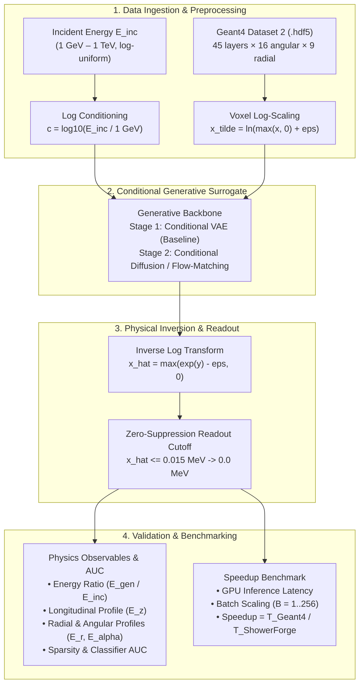
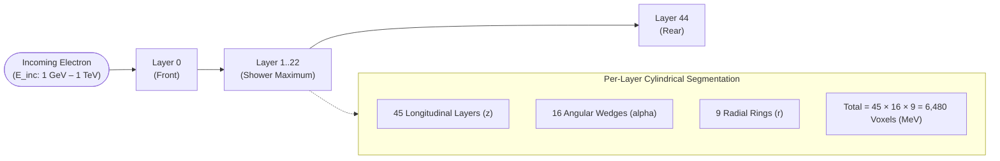

# ShowerForge

**Fast Conditional Generative Surrogate for High-Energy Calorimeter Shower Simulation**

## Project Objective

In High-Energy Physics (HEP) experiments at facilities like CERN's Large Hadron Collider (LHC), simulating particle interactions inside calorimeters using **Geant4** consumes a massive fraction of global computing budgets. Full Monte Carlo tracking of cascading secondary particles—especially up to the $\text{TeV}$ energy scale—creates a severe CPU bottleneck.

**ShowerForge** aims to build, benchmark, and validate a **fast, conditional deep generative surrogate** trained on **CaloChallenge 2022 Dataset 2** to synthesize realistic 3D electromagnetic showers orders of magnitude faster than Geant4 while preserving underlying physical distributions.

### Core Milestones & Outcomes

1. **End-to-End Scalable Pipeline:** Efficiently stream and preprocess $100,000$ cylindrical calorimeter showers ($45 \times 16 \times 9 = 6,480\text{ voxels}$) conditioned on incident electron energies ($1\text{ GeV} \le E_{\text{inc}} \le 1\text{ TeV}$) from HDF5 containers without memory overhead.
2. **Iterative Generative Modeling (Baseline $\rightarrow$ SOTA):**
   - **Stage 1 (Baseline):** Conditional Variational Autoencoder (**cVAE**) to verify data transforms, conditioning, and physical inversion logic.
   - **Stage 2 (High-Fidelity):** Conditional Diffusion / Flow-Matching model to capture sharp structural tails, multi-modal energy deposits, and high voxel sparsity.
3. **Rigorous Physics Validation:** Quantitative benchmarking against held-out Geant4 reference data (`dataset_2_2.hdf5`) across longitudinal, radial, and angular energy profiles, total energy conservation ratios, voxel sparsity, and Classifier Two-Sample Tests (ROC-AUC $\rightarrow 0.50$).
4. **Transparent Speedup Benchmarking:** Reproducible per-event latency comparisons against Geant4 execution on documented GPU hardware and batch configurations.

## System & Pipeline Architecture

GitHub natively renders Mermaid diagrams as vector graphics directly inside `README.md`. Below is the end-to-end architecture diagram:



### Detector Geometry Schematic (Cylindrical Readout Grid)



*(Once your evaluation script runs, you can also embed your generated PNG plots directly here using standard Markdown image syntax, e.g., ``.)*

## Dataset Specifications (CaloChallenge 2022 – Dataset 2)

Dataset 2 simulates single electrons entering a cylindrical **Silicon–Tungsten ($\text{Si–W}$) sampling calorimeter** configured via **Geant4 Par04**:

| Property | Specification |
| :--- | :--- |
| **Source** | [Zenodo Record 6366271](https://zenodo.org/records/6366271) |
| **Files** | `dataset_2_1.hdf5` ($100\text{k}$ train showers), `dataset_2_2.hdf5` ($100\text{k}$ eval showers) |
| **Incident Energy ($E_{\text{inc}}$)** | Log-uniform distribution from $1\text{ GeV}$ to $1\text{ TeV}$ |
| **Detector Grid Geometry** | $45\text{ layers } (z) \times 16\text{ angular bins } (\alpha) \times 9\text{ radial bins } (r)$ |
| **Total Voxels per Event** | $6,480\text{ voxels}$ (stored in $\text{MeV}$) |
| **Readout Cutoff ($\tau_{\text{cut}}$)** | $0.015\text{ MeV}$ (zero-suppression threshold) |

## Mathematical Formulation

### 1. Preprocessing & Conditioning

To stabilize training across three orders of magnitude in incident energy and heavy-tailed, zero-sparse voxel deposits ($\epsilon = 10^{-6}$):

$$
c = \log_{10}\!\left(\frac{E_{\text{inc}}}{1\text{ GeV}}\right), \qquad \tilde{x}_i = \ln\!\left(\max(x_i, 0) + \epsilon\right)
$$

### 2. Physical Inversion & Zero-Suppression

Predicted log-space values $y_i$ are mapped back to physical $\text{MeV}$ units and passed through the detector readout threshold ($\tau_{\text{cut}} = 0.015\text{ MeV}$):

$$
\hat{x}_i^{\text{pos}} = \max\!\left(\exp(y_i) - \epsilon,\, 0\right), \qquad \hat{x}_i = \begin{cases} \hat{x}_i^{\text{pos}}, & \text{if } \hat{x}_i^{\text{pos}} > \tau_{\text{cut}} \\ 0, & \text{otherwise} \end{cases}
$$

### 3. Training Objectives

- **Conditional VAE (Baseline):**
  $$
  \mathcal{L}_{\text{cVAE}} = \mathcal{L}_{\text{recon}}\!\left(\hat{\tilde{\mathbf{x}}}, \tilde{\mathbf{x}}\right) + \beta \cdot D_{\text{KL}}\!\left(q_\phi(\mathbf{z}\mid \tilde{\mathbf{x}}, c) \,\Vert\, \mathcal{N}(\mathbf{0}, \mathbf{I})\right)
  $$
- **Conditional Diffusion (DDPM):**
  $$
  \mathcal{L}_{\text{diff}} = \mathbb{E}_{t,\, \tilde{\mathbf{x}}_0,\, \boldsymbol{\epsilon},\, c}\!\left[\left\|\boldsymbol{\epsilon} - \boldsymbol{\epsilon}_\theta\!\left(\tilde{\mathbf{x}}_t,\, t,\, c\right)\right\|_2^2\right]
  $$

## Repository Structure

```text
ShowerForge/
├── data/                        # Ignored in Git; store dataset_2_1.hdf5 & dataset_2_2.hdf5 locally
├── notebooks/                   # Colab/Kaggle prototyping & exploratory analysis
│   └── 01_eda_exploration.ipynb
├── src/                         # Core modular PyTorch package
│   ├── __init__.py
│   ├── transforms.py            # Log-scaling, energy encoding, and MeV inversion helpers
│   ├── dataset.py               # Lazy-loading HDF5 PyTorch Dataset
│   ├── models.py                # ConditionalVAE & Conditional Diffusion/Flow architectures
│   ├── train.py                 # Training loop with epoch checkpointing
│   ├── generate.py              # Batched shower generation & timing benchmark
│   └── evaluate.py              # Physics observables & Classifier Two-Sample Test (AUC)
├── outputs/                     # Saved checkpoints (.pt) and validation plots (ignored in Git)
├── .gitignore
├── requirements.txt
└── README.md
```

## Quickstart

### 1. Clone & Install Dependencies

```bash
git clone https://github.com/<your-username>/ShowerForge.git
cd ShowerForge
pip install -r requirements.txt
```

### 2. Download Dataset 2

Download `dataset_2_1.hdf5` and `dataset_2_2.hdf5` from [Zenodo (DOI: 10.5281/zenodo.6366271)](https://zenodo.org/records/6366271) and place them in `data/` (or stage them on local NVMe storage `/content/` when running on Google Colab).

### 3. Train Baseline Conditional VAE

```bash
python -m src.train \
  --hdf5_path data/dataset_2_1.hdf5 \
  --epochs 20 \
  --batch_size 128 \
  --ckpt_dir outputs/checkpoints
```

### 4. Generate & Validate Against Geant4

```bash
python -m src.evaluate \
  --ref_path data/dataset_2_2.hdf5 \
  --ckpt_path outputs/checkpoints/cvae_epoch_20.pt \
  --out_dir outputs/figures
```

## Evaluation Metrics & Benchmarks

All generated samples are benchmarked against `dataset_2_2.hdf5` on:

- **Total Energy Ratio:** $E_{\text{gen}} / E_{\text{inc}}$ across energy bins ($1\text{ GeV} \rightarrow 1\text{ TeV}$).
- **Longitudinal Profile ($E_z$):** Mean energy deposition across all $45$ detector layers.
- **Transverse Profiles ($E_r, E_\alpha$):** Radial energy containment across $9$ radial bins and angular symmetry across $16$ angular bins.
- **Voxel Sparsity:** Distribution of zero-energy fraction per shower after applying the $0.015\text{ MeV}$ readout cutoff.
- **Classifier Two-Sample Test (AUC):** Binary neural network trained to distinguish Geant4 vs. generated showers (target $\text{AUC} \approx 0.50$).
- **Inference Speedup:**
  $$
  \text{Speedup} = \frac{T_{\text{Geant4 / event}}}{T_{\text{model / event}}}
  $$
  *(Reported with explicit GPU hardware, batch size $B$, and post-processing overhead included.)*

## References & Further Reading

1. **CaloChallenge 2022 Overview:** C. Krause et al., *Calorimeter Challenge 2022: A Community Challenge for Fast Calorimeter Simulation*, [arXiv:2410.21611](https://arxiv.org/abs/2410.21611).
2. **CaloDiffusion:** V. Mikuni & B. Nachman, *Score-based generative models for calorimeter shower simulation*, [arXiv:2206.11898](https://arxiv.org/abs/2206.11898).
3. **CaloScore:** E. Buhmann et al., *CaloClouds / CaloScore: Score-based Generative Modeling for Calorimeter Shower Generation*, [arXiv:2305.04949](https://arxiv.org/abs/2305.04949).
4. **CaloFlow:** C. Krause & D. Shih, *CaloFlow: Fast and Accurate Generation of Calorimeter Showers with Normalizing Flows*, [arXiv:2106.05285](https://arxiv.org/abs/2106.05285).
5. **Geant4 Par04:** [CERN Geant4 Fast Simulation Documentation](https://geant4-userdoc.web.cern.ch/).
